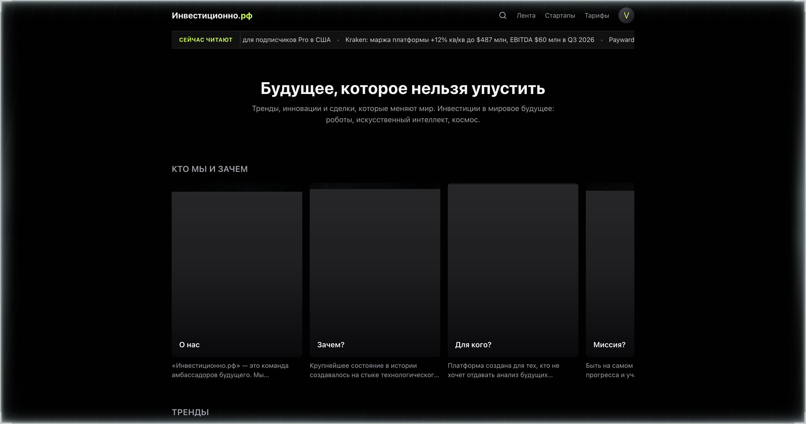
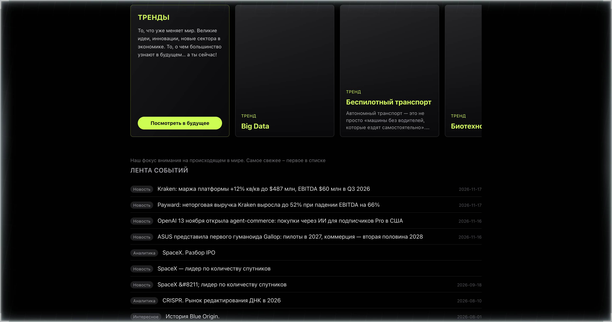
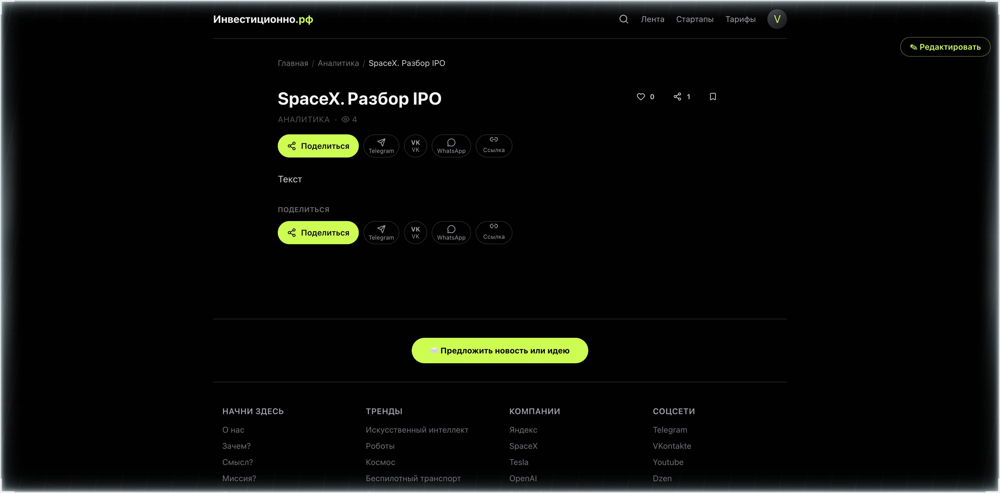

# UX/UI-разбор сайта «Инвестиционно.рф»

**Визуальный стиль, найденные дефекты и приоритезированный список правок**

Дата обзора: 17 ноября 2026 г.
Осмотрены: главная страница, лента событий, подвал, страница аналитики «SpaceX. Разбор IPO».

---

## Содержание

1. [Резюме](#1-резюме)
2. [Что работает: сильные стороны стиля](#2-что-работает-сильные-стороны-стиля)
3. [Проблемы и приоритеты правок](#3-проблемы-и-приоритеты-правок)
4. [Рекомендации по развитию визуального стиля](#4-рекомендации-по-развитию-визуального-стиля)
5. [Чек-лист перед запуском](#5-чек-лист-перед-запуском)

---

## 1. Резюме

Концепция визуального стиля сайта сильная и цельная: тёмная «техно-футуристическая» тема с неоново-лаймовым акцентом точно передаёт позиционирование «про будущее» — роботы, ИИ, космос, стартапы. Палитра дисциплинирована, UI-язык современный.

Однако текущее состояние подачи сыроватое: страницы выглядят недоделанными (пустые карточки, заглушка вместо текста статьи), а видимые пользователю баги (отладочный текст, нерасшифрованные HTML-сущности, битые иконки) подрывают доверие к изданию сильнее, чем любые шрифтовые решения.

**Главный вывод:** стилевой фундамент — оставить и развивать; перед запуском закрыть все дефекты уровня P0 и P1 из раздела 3.

## 2. Что работает: сильные стороны стиля

- **Цельная концепция.** Почти чёрный фон + лаймовый акцент — узнаваемый образ «медиа о будущем», прямое попадание в тематику.
- **Дисциплина палитры.** Лайм используется точечно: логотип, кнопки, метки «ТРЕНД», заголовки карточек. Визуальный шум отсутствует.
- **Современный UI-язык.** Скруглённые карточки, «пилюли»-кнопки, призрачные кнопки соцсетей, капсовые рубрики — актуальный tech/финтех-вокабуляр.
- **Типографика и иерархия.** Гротеск, понятная последовательность «рубрика → заголовок → лид»; лента событий с бейджами «Новость»/«Аналитика» и датами читается легко.
- **Сетка и отступы.** Ограниченная по ширине контентная колонка, ровные ряды карточек, воздух между блоками.

*Рис. 1. Главная страница: тёмная тема, лаймовый акцент, карточки без обложек*

*Рис. 2. Лента событий — лаконичная типографика; виден баг с HTML-сущностью*

## 3. Проблемы и приоритеты правок

Приоритеты: **P0** — критично, блокирует запуск; **P1** — важно, заметно портит впечатление; **P2** — желательно, полировка.

| Приоритет | Проблема | Где | Что делать |
|---|---|---|---|
| **P0** | Страница статьи пустая: вместо текста — слово «Текст», блок «Поделиться» продублирован дважды подряд | `/analitika/ipo-spacex-razbor` | Залить реальный контент, убрать дубль блока шеринга, проверить шаблон статьи |
| **P0** | Карточки без изображений: серые пустые плейсхолдеры в блоках «Кто мы и зачем» и «Тренды» | Главная | Добавить обложки всем карточкам либо ввести осмысленный skeleton/error-стейт |
| **P0** | Отладочный текст «пернерс-тест zod4» виден на странице рядом с карточками аналитики | Главная, блок аналитики | Убрать тестовые артефакты из production-сборки |
| **P1** | HTML-мнемоник не декодируется: «SpaceX `&#8211;` лидер по количеству спутников» | Лента событий | Декодировать сущности при выводе заголовков (`html_entity_decode`) |
| **P1** | Битая иконка в лаймовой кнопке «Предложить новость или идею» | Главная, подвал, статья | Восстановить файл иконки или заменить на inline-SVG |
| **P1** | Кнопка «Редактировать» доступна на странице статьи — похоже, админский контрол не скрыт от гостей | Страница статьи | Показывать редакторскую кнопку только авторизованным редакторам |
| **P2** | Синяя кнопка Telegram-бота выпадает из чёрно-лаймовой палитры | Главная, блок «Дайджесты» | Привести к фирменному стилю (лайм/призрачная) либо осознанно закрепить как исключение |
| **P2** | Дублирующиеся заголовки в ленте: «SpaceX — лидер по количеству спутников» встречается дважды с разными датами | Лента событий | Проверить дедупликацию материалов при публикации |
| **P2** | Серая подводка «Наш фокус внимания…» мельче и светлее капсового заголовка «ЛЕНТА СОБЫТИЙ» под ней — иерархия перевернута | Главная, лента | Сделать заголовок крупнее либо поменять их местами |

*Рис. 3. Страница аналитики: контент-заглушка «Текст», продублированный блок «Поделиться», видимая кнопка «Редактировать»*

## 4. Рекомендации по развитию визуального стиля

### 4.1. Доступность и читаемость

- Проверить контраст серых вторичных текстов на чёрном фоне (подводки, даты, метаданные) — по WCAG для основного текста нужно не менее 4.5:1.
- Не использовать лаймовый как цвет длинных текстовых фрагментов — только для акцентов и кликабельных элементов.

### 4.2. Состояния и отказоустойчивость

- Ввести аккуратный skeleton-лоадер и error-стейт для обложек карточек, чтобы недогруз изображения не превращался в серые прямоугольники.
- Единый набор иконок (сейчас одна битая) — лучше inline-SVG-спрайт в фирменных цветах.

### 4.3. Системность

- Зафиксировать дизайн-токены: палитру, радиусы скруглений, отступы, стили кнопок — чтобы новые страницы не «расползались» (уже виден разнобой в иерархии заголовков ленты).
- Исключения из палитры (синий Telegram) либо убрать, либо документировать как осознанное отклонение.

## 5. Чек-лист перед запуском

1. Статьи и аналитика отображают полный текст, без заглушек и дублей блоков.
2. Все карточки имеют обложки или корректный fallback.
3. Ни на одной странице нет отладочных и тестовых строк.
4. Заголовки в ленте рендерятся без HTML-сущностей; дедупликация новостей работает.
5. Все иконки и изображения загружаются (проверить в консоли на предмет 404).
6. Редакторские контролы скрыты от гостей.
7. Контраст текста соответствует WCAG AA.
8. Проверка на мобильных разрешениях: карточки, лента, кнопки шеринга.
